# Public Equity Screener

**A native macOS screener for stocks that institutions were forced to sell.**

When volatility jumps, many institutions cut risk mechanically: VaR limits, volatility targets
and redemptions make them sell what they hold most, often last year's winners, whatever the
fundamentals. Public Equity Screener looks for exactly those stocks: strong, cash-generating
names that dropped hard into a VIX (or VSTOXX) spike without company news to explain it. It then
lets you test whether that idea has paid off historically.


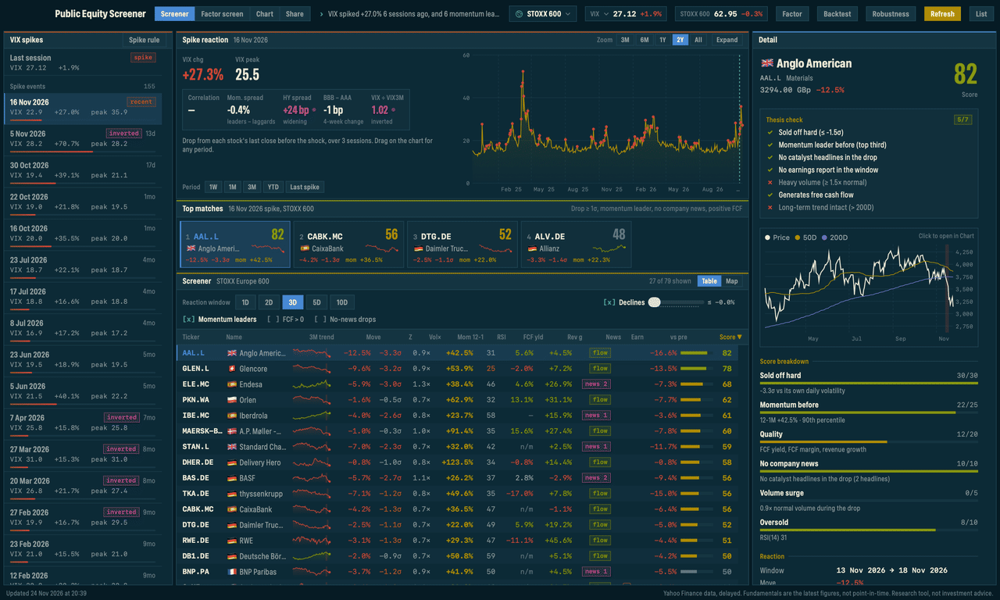

> **Screening and research only.** The app ranks, flags and backtests. It does not suggest
> orders, position sizes or trades, and nothing here is investment advice.

---

## Contents

- [Features](#features)
- [Share cards for Threads and X](#share-cards-for-threads-and-x)
- [Getting started](#getting-started)
- [Keyboard shortcuts](#keyboard-shortcuts)
- [Command line](#command-line)
- [Universes and data](#universes-and-data)
- [How the score works](#how-the-score-works)
- [Research tools](#research-tools)
- [Project layout](#project-layout)
- [Caveats](#caveats)
- [License](#license)

## Features

### Screener

Every past volatility spike is listed on the left; pick one (or drag across the VIX chart to
choose any period) and every stock is re-measured over its reaction window. The table shows the
drop in units of each stock's own volatility, prior momentum, volume surge, free-cash-flow yield,
headlines, earnings dates and a 0–100 score, with a 3-month sparkline per row. The five best
matches sit above the table and in the **menu bar**.

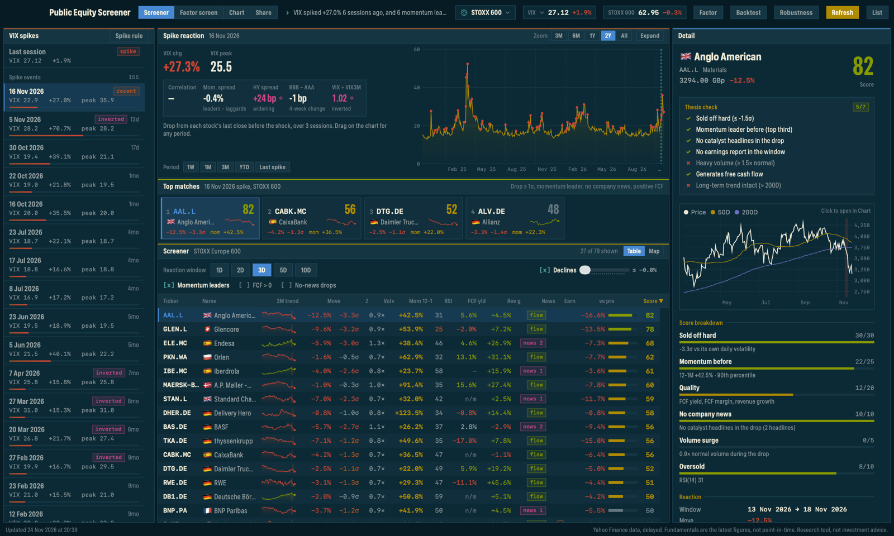

- **Forced-selling gauges:** average pairwise correlation, momentum spread (leaders minus
  laggards), high-yield credit spread, the BBB − AAA quality spread (Moody's Baa − Aaa from FRED)
  and the VIX ÷ VIX3M term structure.
- **Earnings flags:** an orange **E** marks a report inside the window (the drop may be the
  report, not forced selling) and fails the thesis check; a blue **E 5d** marks one coming up.
- **News check:** Yahoo headlines during the drop are scanned for catalysts (earnings, guidance,
  downgrades, deals…). No catalyst means the drop looks like flow.
- **Thesis checklist and score breakdown** for the selected stock, with a price chart that opens
  in the full charting view.

### Shock map

Every stock plotted by momentum before the spike (across) against how hard it was sold (down).
The bottom-right thesis zone is where strong stocks were dumped; dot size is market cap, colour
is score, and a hollow ring means company news explains the drop.

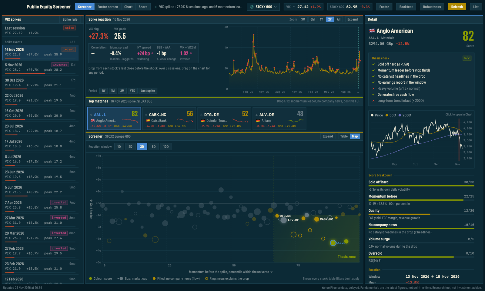

### Factor screen

The thesis as a systematic weekly factor: momentum leaders ranked by
−(5-day drop in σ) × (recent ÷ prior volatility). Shows the stress regime (calm, risk-budget
selling or credit crisis), the top-ranked names by sector, a card per name, which names entered
or left the top list since last week, and a research backtest against the index and an
all-momentum-leaders control.

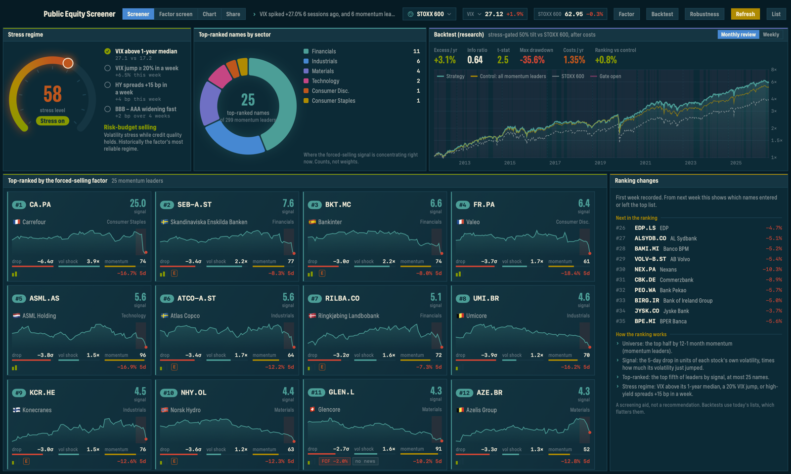

### Charting

TradingView-style charting built on a custom Canvas renderer: candles, hollow candles, Heikin
Ashi, OHLC, line and area; daily, weekly and monthly bars; log scale; SMA 20/50/200, EMA 21,
Bollinger Bands, volume, index comparison and spike markers; RSI, MACD, vol-shock and VIX panes;
trend lines, rays, levels, Fibonacci retracements and rectangles saved per stock; a measuring
ruler; pinch, scroll and keyboard navigation.

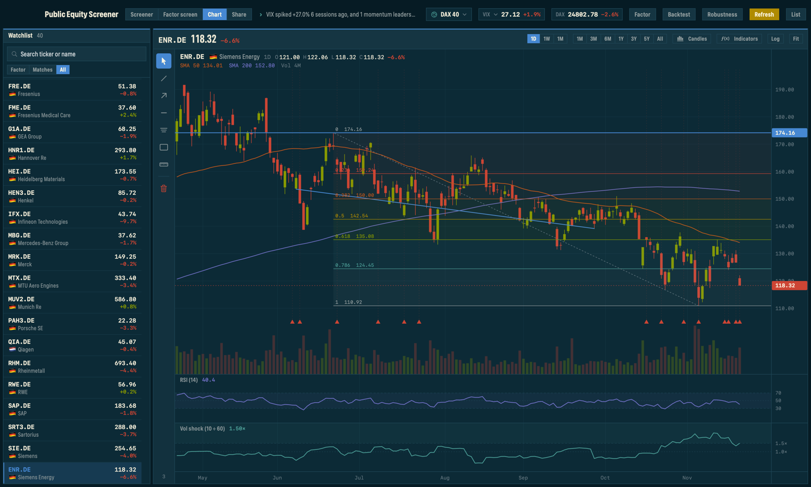

### Light mode

Every view follows the system appearance (Solarized dark and light).

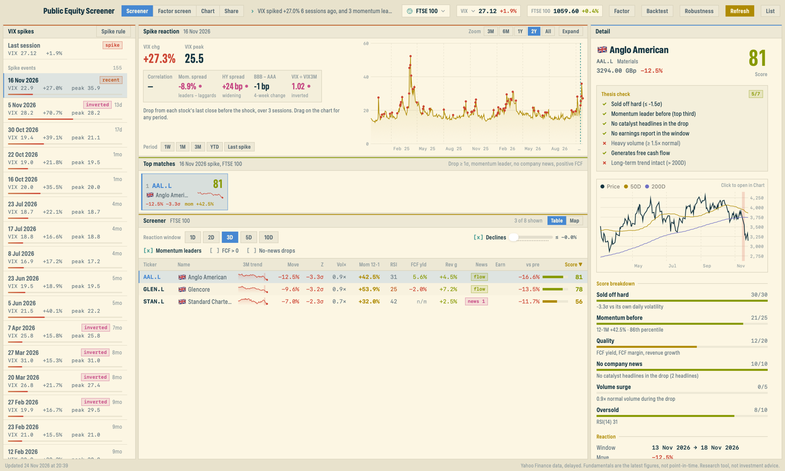

## Share cards for Threads and X

Share mode (⌘4) turns the data into clean social images: pick a card, a format and a theme, then
**Copy image** (⇧⌘C) straight into a post or **Save PNG…** (⌘S).

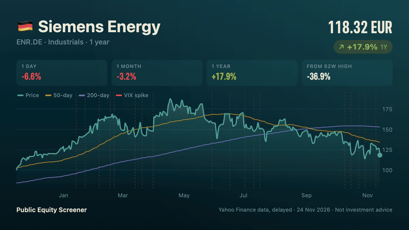

| | |
|---|---|
| **Cards** | Stock chart (50/200-day averages, spike markers) · Stock vs index (rebased to 100) · Volatility index · Top matches |
| **Formats** | 16:9 for X (1600 × 900) · 4:5 for Threads (1080 × 1350) · 1:1 square (1080 × 1080) |
| **Themes** | Solarized dark · Solarized light · Terminal amber · Midnight · Neon · Newsprint · Mono |
| **Text** | Automatic title and subtitle (editable), optional caption |
| **Footer** | App name, data source and date, "Not investment advice" (can be switched off) |

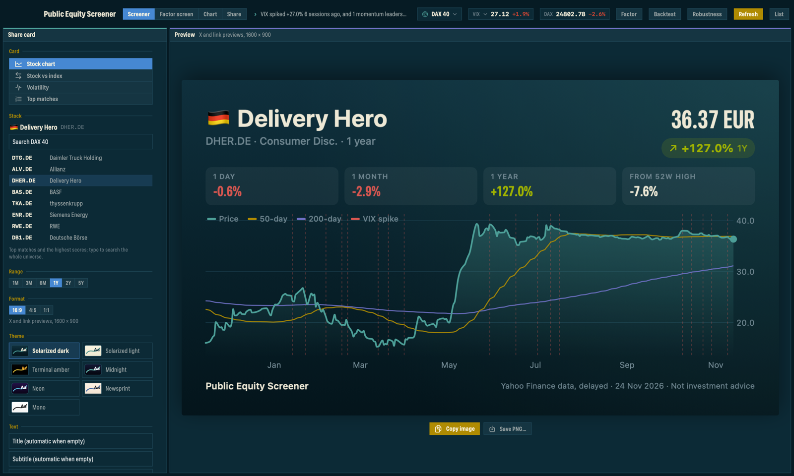

<p>
  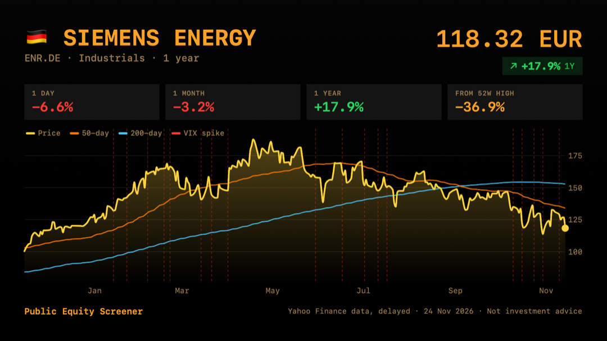
  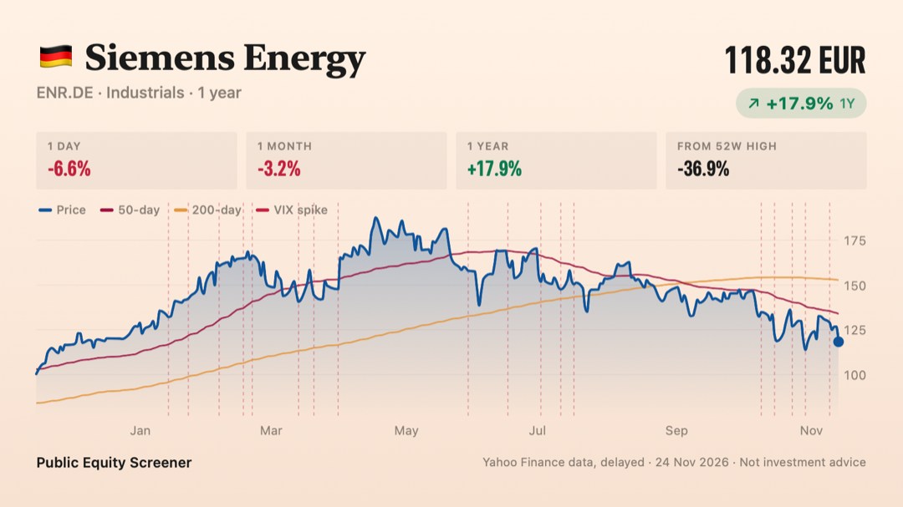
</p>

## Getting started

Requirements: macOS 15 or later, and Xcode 16+ (or its command line tools) for Swift 6.

```bash
git clone https://github.com/tillknuesting/public-equity-screener.git
cd public-equity-screener
./build.sh --open
```

`build.sh` compiles a release build and assembles `build/Public Equity Screener.app` (ad-hoc
signed). The first launch downloads 16 years of daily prices for the chosen universe, which takes
a minute; after that everything is cached in `~/Library/Application Support/MarketScreener/` and
refreshes every 30 minutes.

No accounts or API keys are needed.

## Keyboard shortcuts

| Shortcut | Action |
|---|---|
| ⌘1 / ⌘2 / ⌘3 / ⌘4 | Screener / Factor screen / Chart / Share |
| ⌘R | Refresh data |
| ⌘K | Risk-budget factor report |
| ⌘B | Spike backtest ("Is there alpha?") |
| ⌘G | Robustness grid |
| ↑ / ↓ | Move through the screener |
| ⇧⌘C / ⌘S | Copy / save the share card |
| Chart: scroll, pinch, drag, ←/→, ↑/↓, double-click | Zoom, pan, reset |

## Command line

The same binary runs headless, which is handy for cron jobs and quick checks:

```bash
swift run MarketScreener --picks --stoxx            # today's top 5 matches
swift run MarketScreener --scan --dax --window 3    # the full screen as a table
swift run MarketScreener --backtest --ftse100       # spike backtest with alpha and t-stats
swift run MarketScreener --factor --msci            # risk-budget factor by regime
swift run MarketScreener --strategy --stoxx         # stress-gated backtest variants
swift run MarketScreener --robustness --dax -volIndex VSTOXX
swift run MarketScreener --share-card card.png --dax --symbol ENR.DE --template stock --format 4:5 --theme terminal
swift run MarketScreener --data-check --stoxx       # implausible price moves in the cache
```

Universe flags: `--msci`, `--ftse` (FTSE Global All Cap top 500), `--ftse100`, `--dax`,
`--stoxx`, `--sectors`. Add `--offline` to use only the cache, `--refresh` to force a download, and
`-volIndex VSTOXX` to use VSTOXX for one run.

## Universes and data

| Universe | Names | Benchmark | Built by |
|---|---|---|---|
| MSCI World top 100 | 100 | URTH | hand-maintained list |
| FTSE Global All Cap top 500 | 500 | VT | `tools/build_ftse500.py` (market-cap ranking) |
| FTSE 100 | 100 | ISF.L | `tools/build_ftse100.py` |
| DAX 40 | 40 | ^GDAXI | `tools/build_dax40.swift` (free-float market cap) |
| STOXX Europe 600 | 600 | EXSA.DE | `tools/build_stoxx600.swift` (16 exchanges, one line per company, free-float cap in EUR) |
| Sector ETFs | 30 | URTH | hand-maintained list |

The index lists are approximations rebuilt from public data, since index providers don't publish
constituents for free. Each list is copied to `~/Library/Application Support/MarketScreener/` on
first use, where you can edit it (menu: List → Edit).

**Sources (all free, no keys):**

- **Yahoo Finance:** daily prices (dividend-adjusted), fundamentals, headlines, earnings dates.
- **STOXX:** VSTOXX and its 3-month sub-index (daily history files).
- **FRED:** Moody's Baa and Aaa yields, for the quality spread.
- **iShares ETFs as proxies:** high-yield credit (HYG vs IEI).

Data is delayed and unofficial. The app repairs Yahoo's worst glitches on load: London prices
that flip between pence and pounds, one-day bad prints, and broken early history.

## How the score works

| Part | Max | Meaning |
|---|---|---|
| Sold off hard | 30 | Drop over the reaction window in units of the stock's own 60-day volatility (z) |
| Momentum before | 25 | 12-1 month return before the spike, percentile within the universe |
| Quality | 20 | FCF yield, FCF margin, revenue growth (earnings yield and growth for financials), ranked |
| No company news | 10 | No catalyst headlines and no earnings report during the drop |
| Volume surge | 5 | Volume during the drop vs. the 20 sessions before (2.5× = full points) |
| Oversold | 10 | RSI(14) |

The reaction window starts at each stock's last close before the spike (Asia-Pacific stocks use
the spike-day close, since they trade before the US reacts) and runs 1–10 sessions forward.
**Top matches** are the best scores among stocks that pass every gate: drop ≥ 1σ, top-third
momentum, no company news or earnings in the window, positive free cash flow.

## Research tools

These exist to keep the idea honest; they are research, not a strategy to follow.

- **Spike backtest (⌘B):** replays the screen at every spike since 2011 and reports what the
  thesis matches, the top and bottom 10 by score and all stocks did over 1 week, 1 month and
  3 months: beta-adjusted alpha, t-statistics, non-overlapping spikes, long/short spreads that
  cancel survivorship bias, rank ICs per score component, and regime splits (inverted VIX curve,
  correlation, credit and quality spreads).
- **Risk-budget factor (⌘K):** the weekly and monthly factor's long−short and long-only returns by
  regime (calm, stressed, VIX shock, credit widening, credit crisis), after costs of 5 and 10 bp.
- **Strategy variants:** a stress-gated tilt into the ranking, with weekly and low-turnover
  rules, per-market transaction taxes (UK and Irish stamp duty, French, Italian and Spanish FTT…)
  and fair controls.
- **Robustness grid (⌘G):** the low-turnover rule was chosen after seeing results, so the grid
  reruns it across neighbouring settings, against the index and against a control, at three cost
  levels. A result that only works at the chosen cell is luck.

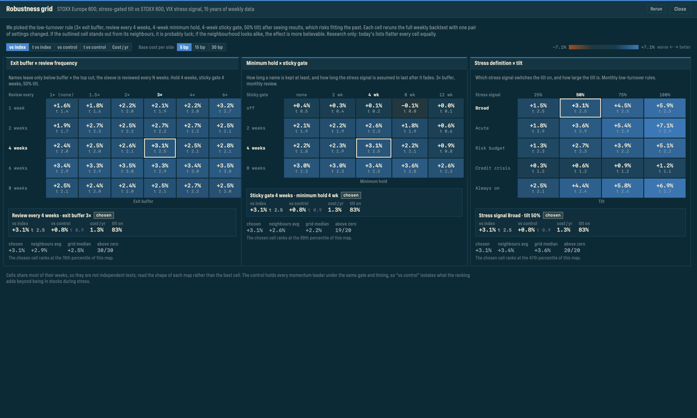

## Project layout

```
Sources/MarketScreener/
  ScreenerStore.swift        state, data loading, caching
  YahooClient.swift          Yahoo, STOXX and FRED clients
  Screener.swift             thesis metrics and scoring
  Analytics.swift            indicators, spike detection, stress gauges
  Backtest.swift             spike backtest
  RiskBudgetFactor.swift     the weekly/monthly factor
  SwitchingStrategy.swift    stress-gated backtest variants, transaction costs
  Robustness.swift           the parameter grid
  ProChart.swift, ChartModel.swift, ChartWorkspace.swift   charting
  ShareCards.swift, ShareStudio.swift                      share cards
  Universe*.swift            universe lists (generated by tools/)
  Entry.swift                app entry point and command-line modes
tools/                       scripts that rebuild the index lists
build.sh                     builds the .app bundle
```

## Caveats

- **Survivorship bias.** Backtests use today's index lists, which flatters every long-only result;
  the long/short spreads and the all-leaders controls cancel most of it, but not all.
- **Look-ahead in fundamentals.** Fundamentals are the latest reported figures, not
  point-in-time, so historical replays have look-ahead in the quality score (there is a switch to
  exclude it).
- **News coverage.** The headline feed only reaches back about two weeks.
- **Data terms.** Data comes from unofficial endpoints and may break or be rate-limited; check
  the providers' terms before using it beyond personal research.
- **Not advice.** Nothing in this project is investment advice.

## License

[GPL-3.0](LICENSE)
